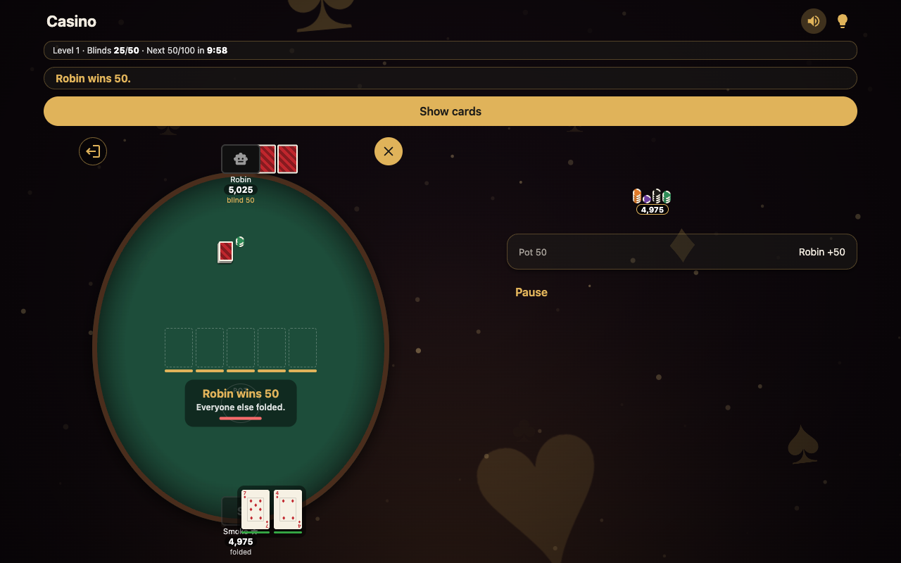
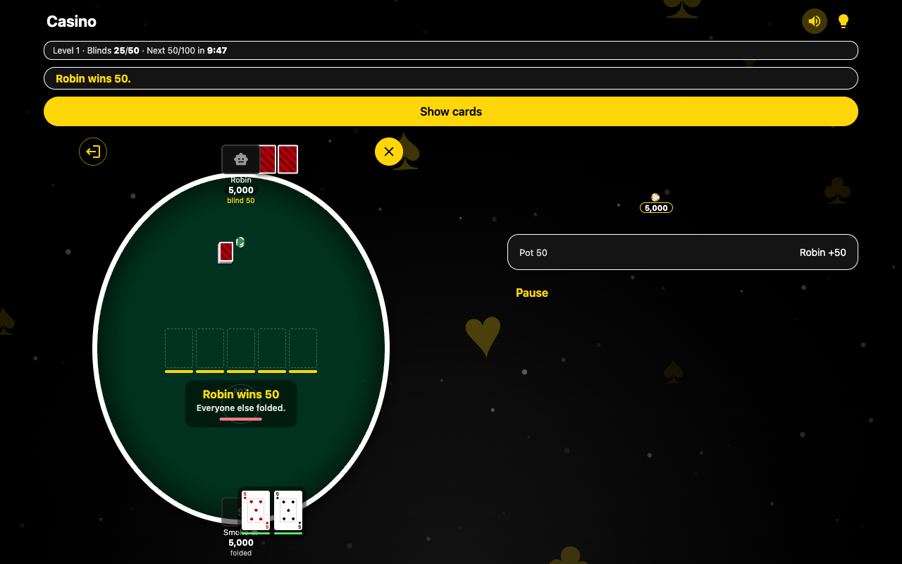

# Foundation verification

Overall acceptance is partial. This session's audit verifies all 41 release archives, their package signatures and class checks, and the managed application bytes. Independent acceptance of these release archives has not run. Retained whole-tree application verification is blocked by dependency-created symbolic links; build/gameplay logs are not signed application execution attestations.

## Release versions

Each package repository holds one local commit, `<name> <version>: <scope>`; the committed trees are the archives in [final evidence](final-evidence.json). Class versions are 1.0.0.

| Package | Version | Commit | Package | Version | Commit |
|---|---|---|---|---|---|
| android-host | 0.7.0 | 29c7b45 | presence | 0.7.0 | 63e5191 |
| apple-host | 0.9.0 | b1116ad | private-views | 0.7.0 | b7823b8 |
| card-deck | 0.7.0 | 2768291 | realtime-rooms | 0.9.0 | 882bab9 |
| card-graphics | 0.8.0 | cf809ab | room-directory | 0.7.0 | 0601a79 |
| chip-graphics | 0.8.0 | 090932f | round-history | 0.7.0 | c5ae7bf |
| chip-ledger | 0.8.0 | c66e622 | rules-settings | 0.7.0 | dccc1b1 |
| computer-players | 0.8.0 | da2dbd9 | seating | 0.7.0 | 92eaa09 |
| controls | 0.8.0 | 8a7bae7 | server-host | 0.8.0 | 90474e8 |
| display-mode | 0.8.0 | c1592d0 | sound-cues | 0.8.0 | 1d93c10 |
| fair-shuffle | 0.7.0 | 1cfc530 | store-update | 0.8.0 | 538d755 |
| game-clock | 0.7.0 | 346e44a | table-layout | 0.8.0 | f476cec |
| guest-identity | 0.8.0 | 6db29d6 | theme | 0.8.0 | 788293b |
| guided-tour | 0.8.0 | efc1077 | theme-high-contrast | 0.4.0 | 609e9b1 |
| holdem-rules | 0.7.0 | ed06745 | tournament | 0.7.0 | a9ac43a |
| invitations | 0.5.0 | 8b95c7b | translations | 0.8.0 | 9f6afc0 |
| level-schedule | 0.7.0 | 8cd601e | turn-engine | 0.8.0 | b8a0a7b |
| ourapps-release | 0.8.0 | ae84719 | video-calls | 0.9.0 | 820edea |
| poker-hand-ranking | 0.7.0 | 33abd46 | web-host | 0.7.0 | 95f8055 |
| poker-odds | 0.7.0 | 79bb525 | windows-desktop | 0.8.0 | d81c6ce |
| poker-strategy | 0.7.0 | a952bce | ourpoker (recipe) | 0.8.0 | 5598662 |
| preferences | 0.5.0 | 4a2a334 | | | |

## Toolchains and doctor

`classes/provenance.py` (`TOOLCHAINS`) writes one definition per tool into every package's `toolchains`, by declared platform; definitions are byte-identical, so graph merges never conflict.

| Tool | Range | Platforms | macOS / Windows / Linux installer |
|---|---|---|---|
| node | >=26.5.0 <27.0.0 | server, web, windows | brew / winget OpenJS.NodeJS / manual (nodejs.org or NodeSource) |
| xcodebuild | >=27.0.0 <28.0.0 | ios, macos, tvos | manual (Xcode 27; Apple targets build only on macOS) |
| xcodegen | >=2.46.0 <3.0.0 | ios, macos, tvos | brew / none / none |
| java | >=17.0.0 <27.0.0 | android | brew temurin / winget Temurin 21 / apt openjdk-21-jdk |
| sdkmanager | >=22.0.0 <23.0.0 | android | brew android-commandlinetools / manual 22.0 zip (23.0 replaces sdkmanager) |

- This Mac, default targets plus Cloudflare: `ok` true; java 26.0.1, node 26.5.0, sdkmanager 22.0.0, xcodebuild 27.2.0, xcodegen 2.46.0.
- With xcodegen off `PATH`: exit 1, xcodegen `missing` with install `brew install xcodegen`; the other four `ok`.
- Windows 11 (web, windows): node 22.20.0 `wrong-version`, no winget; Node 26.13.1 from the nodejs.org zip then `ok`. With android: java 21.0.13 and sdkmanager 22.0 `ok`.

## In-place update

aepm 3b6c185, installed `local-web` application (33 components, serverAddress and webAddress changed, `node_modules` and `dist` removed): `propose-update --trusted --allow-network` in 6 min 25 s, report 46,287 bytes, 112 suites; `approve`, `apply`, `recover` ok; the applied tree carries the new addresses. In a git checkout with an unmanaged `CHANGELOG.md`, apply kept `.git` and the file; `git status` showed only the managed changes. A tree after `npm ci` is refused (`special-file`, `node_modules/.bin`).

## Windows 11 (PowerShell 5.1, Smart App Control on)

- `aepm questions`, `design`, `doctor`, `resolve`, `install` from a copied local store; install needs a short parent folder (a 34-character parent stopped with `invalid-input` at `assemble`; long paths are off).
- Server: `npm ci`, type check, 34 tests (no output-gate noise), `npm start` health ok. Web: `npm ci`, type check, build. Desktop: `npm ci`, `npm run check`, `npm run build`.
- `npm run package:win`: exit 1, `spawn UNKNOWN`; Code Integrity logged Smart App Control blocking the unsigned installer electron-builder runs to write its uninstaller. `package.cjs` exits 1 on any failure.
- Android: JDK 21 and command-line tools 22.0 from zips; `gradlew.bat :app:assembleDebug :app:testDebugUnitTest --dependency-verification=strict` passed (4 unit tests) after the aapt2 Linux/Windows and kotlinx-coroutines-bom 1.8.0 checksums, each matched to the repository's published sha256 and sha1.
- `C:\Users\georg\Projects\recipe-win`, the two application folders, assembly leftovers, `~\.gradle` and `~\.android` were removed.

## Workflows

Recipe `implementation/repository/workflows/` and ourapps-release templates (rendered with `renderRelease` and `renderMaintenance`) pass actionlint with shellcheck. ci-web plays `web/test/browser.mjs` against a server started on the runner; ci-android builds against `10.0.2.2:8788`, boots an API 36 emulator with KVM and runs `android_screen.py` until the room list shows (run here against a local server: PASS from a fresh install); apple-builds builds iOS Simulator, Mac Catalyst and tvOS unsigned on macos-26 with Xcode 27 on tags and by hand; aepm-update proposes weekly as a pull request and applies on merge with `AEPM_OWNER_KEY`. Every check workflow has `workflow_dispatch`. Not run on GitHub.

## GitHub runs (0.8.0 candidate, throwaway repository ourapps-ae/ourpoker-cloud-2)

| Workflow | Runner | Result | Run |
|---|---|---|---|
| ci-server | ubuntu-latest | passed, 33 s | https://github.com/ourapps-ae/ourpoker-cloud-2/actions/runs/44498422375 |
| ci-web (browser hand against the runner's server) | ubuntu-latest | passed, 52 s | https://github.com/ourapps-ae/ourpoker-cloud-2/actions/runs/44498422342 |
| ci-android (API 36 emulator reaches the room list) | ubuntu-latest | passed, 7 min 32 s | https://github.com/ourapps-ae/ourpoker-cloud-2/actions/runs/44498422353 |
| platform-packages (Windows installer installed, started, removed) | windows-latest | passed, 2 min 7 s | https://github.com/ourapps-ae/ourpoker-cloud-2/actions/runs/44498422335 |
| apple-builds by hand (iOS Simulator, Mac Catalyst, tvOS, unsigned) | xcode-27 | passed, 15 min 28 s | https://github.com/ourapps-ae/ourpoker-cloud-2/actions/runs/44498447646 |
| release on tag v0.1.0 (web.zip, ourpoker.apk, Windows installer, my-app.json, icon.png, CHANGELOG.md) | ubuntu, windows | passed, 3 min 56 s | https://github.com/ourapps-ae/ourpoker-cloud-2/actions/runs/44498459071 |
| aepm-update propose, answers {"languages":["en","fr"]}, aepm 201c35a | ubuntu-latest | passed, opened pull request 1 | https://github.com/ourapps-ae/ourpoker-cloud-2/actions/runs/44502252500 |
| aepm-update apply after merging pull request 1 | ubuntu-latest | passed, committed d29068e (10 files) | https://github.com/ourapps-ae/ourpoker-cloud-2/actions/runs/44503519546 |
| ci-server, ci-web, ci-android by hand after the apply | ubuntu-latest | passed | runs 44505192677, 44505199064, 44505206026 |

The update runs used a test copy of `aepm_update.py` and `aepm-update.yml` that read the candidate packages, disposable release and guardian keys and aepm 201c35a from a release attached to the throwaway repository; the published workflow reads them from ourapps.app and github.com/ourapps-ae/aepm.

## Classes and coverage

- 39 independent class directories, one per recipe slot; 40 providers, including both themes.
- 42 passed signed shared suite results per package-review store: 40 operation suites and two compiled Swift theme-value suites, covering all providers including both themes.
- Each retained default application selects 37 components and the recipe; the local-web application selects 33. The package-review results are not application-context execution results.
- Every class checks actual operations; none uses export counts as its behavioural check.
- [Per-class operations and coverage boundaries](../README.md#behaviour-checked).
- Both theme providers receive identical interface, script, fixture and descriptor bytes.
- The defective theme passes its own check and declared class fit with a provider-specific document, fails shared colour-override behaviour, and is refused guardian signing: [evidence](failing-substitute.json).

## Package metadata

- Wrapper licence and notice documents retain their supplied bytes. Owners are Level N Ltd; contacts, repositories and update sources use the configured repository origins.
- npm source records use exact package-lock version 3 package paths, versions and integrity. Swift source records use resolved format 3 source revisions. Gradle records bind configuration locks and the exact SHA-256 artifact inventory.
- Supplied source/binary notices are retained, including the WebRTC binary's BSD terms alongside its wrapper's MIT terms. Maven project documents and package.json licence fields are labelled declarations. Plugin-marker metadata without a supplied licence declaration uses `NOASSERTION`; no grant is fabricated.
- Material Design icon data has a content-addressed snapshot identity; its upstream release tag is unspecified.
- The Gradle 9.4.0 wrapper matches its published SHA-256. Its embedded Apache licence is included; the observed input wrapper is preserved by digest under `inputs/`.
- The Android XML parser is bundled `@xmldom/xmldom` 0.8.15 with its exact source inventory and supplied MIT licence.
- Runtime/framework constraints, shared versus isolated pins, actual global stylesheet footprints and platform module maps are explicit. Windows browser modules run through Electron; Apple application builds use Mac Catalyst for the Mac target.
- Manifests contain no verification dates or self-referencing archive digest. Execution times belong to signed reports.
- Every repository's `.gitattributes` is `* -text`, so supplied notices and generated locks are stored byte-for-byte.

## Source paths and functions

| Paths | Functions or resulting data |
|---|---|
| `classes/*-class/class.json`, interface files, `check.mjs`, fixtures | Independent contracts, common module paths, closed setting schemas, inventory-bound operation checks |
| `classes/runtime.mjs` | `source`, `load`, `data`: staged-source access through the supplied module map |
| `classes/generate.py` | `class_bundle`, `bundle_into`, `metadata`, `main`: canonical descriptors, package bundles, authoring metadata and exact recipe references |
| `classes/provenance.py` | `npm_source`, `upstream`, `wrappers`, `bundled_sources`, `styles`, `foundations`, `provenance_document` |
| `classes/native_provenance.py` | `maven_source`, `source_notice`, `swift_sources`, `gradle_sources`, `native_sources` |
| `classes/start_proof.py`, `classes/check_evidence.py` | Installation proofs for any answer sets; archive, signature, class-result and managed-byte audit |
| `components/*/component.json`, `authoring/spec.json`, realtime-rooms `authoring/{package,foundations}.json`, `PROVENANCE.md`, `classes/`, `notices/` | Generated foundation declarations, explicit licences, actual implementation folders, targets, modules and installer templates |
| `components/android-host/implementation/android/render.ts` | `DependencyFiles`, `lockedDependencies`, `validateDependencyFiles`, `writeWrapper`: complete four-file inputs, syntax/coverage validation before writes, supplied-map replacement without merging |
| Android host settings, Gradle templates, dependency files, vendor source, interface, consumer, tests and source documents | Importable numeric setting template, active dependency locking, exact parser source, complete consumer output and documented input map |
| `components/realtime-rooms/implementation/web/live.ts` | Explicit fields and constructor assignments for direct TypeScript execution |
| `components/realtime-rooms/scripts/package-metadata.py` | Authored package/foundation declarations and canonical output |
| `components/video-calls/implementation/server/index.ts`, `tsconfig.json` | Explicit TypeScript import extension and matching compiler setting |
| `recipes/ourpoker/authoring/make_recipe.py` | `slot_class`, `main`: references to independent descriptors; no implementation-derived class definitions |
| `recipes/ourpoker/scripts/make_component.py` | `dump`, `build_manifest`: canonical manifests and retained foundation declarations |
| `recipes/ourpoker/authoring/try_install.py` | `prepare_store` uses `policy=Path`; `native`, `android_run`, `browser_smoke` and `BROWSER_SMOKE` enforce pins and complete hands through actual controls |
| Recipe native generators and dependency inventories | Select video/no-video inputs, verify all selected hashes, copy complete locks, and use resolved Swift package versions |
| Recipe styles and generated-file exclusions | Theme variables have one owner; generated lock outputs are excluded while installed pin inventories remain managed |
| Recipe validator helper, consistency test, page status and review guide | Authoritative class context; the 0.6.0 proof results |
| `tools/scaffold_component.py` | Authorized `load_spec`, `build_manifest`, `scaffold` changes for mandatory metadata, explicit templates and compact canonical output |
| `tools/tests/test_licence_preservation.py` | Authorized fixture update to the current foundation shape; licence-byte checks remain |

## Commands and results

Commands use Python 3.12 with bytecode disabled and the aepm checkout on the module search path.

| Command | Result |
|---|---|
| `tools/sync_visual_versions.py components/* --check` | Every visual file names its manifest version |
| `tools/sync_required_interfaces.py --check` | 45 required documents; none differ; no class conflicts |
| `classes/check_local.py` | 42/42 shared executions pass, including compiled Swift values for both themes |
| `classes/prove_defect.py` | Candidate check passes; shared behaviour fails; guardian refuses |
| `classes/check_reproduction.py` | 365 files reproduced byte-identically in one generator run |
| `classes/check_scaffolder.py` | All 34 specs reproduce seven foundation fields (toolchains included), class bundles, templates and supplied licence bytes |
| `tools/check_component.py --all --allow-network` | 40/40 packages pass with no errors; documented platform skips and development warnings remain |
| `node --test tests/recipe.test.ts tests/portable.test.ts` | 38 tests pass with the compatible catalogue checkout selected |
| `tests/evaluate_recipe_test.py` | 47 tests pass, including 18,144 connectability combinations and the Common Expression Language comparison; inclusion assertions sample every 37th combination |
| `tests/conditional_artefacts_test.py` | 17 tests pass |
| `authoring/check_conditional_artefacts.py -v` | 16 answer sets; no violations |
| `node $OURAPPS/scripts/validate-recipe-file.ts recipe.json` | Valid against ourapps-foundations at origin/main (b35619f), 40 components read |
| `tools/validate_catalogue.py --catalogue <ourapps-foundations at origin/main>` | ok for all 41 packages |
| Android dependency verification | The default design's Android build on this Mac and the no-video build on Windows 11 pass with strict verification; aapt2 macOS, Linux and Windows jars match Google Maven's published sha256 and sha1 |
| Package reviews (aepm 3b6c185) | Per store: 119 suites passed, 29 blocked (Android/Kotlin tools not installed, external contexts), none failed |
| `aepm doctor ourpoker@0.7.0` on this Mac | ok: all five tools in range |
| actionlint (with shellcheck) | Recipe workflows and every rendered ourapps-release workflow pass |
| `classes/regressions.py` | components, node, evaluator, conditional, artefacts and catalogue steps exit 0 |
| Package and signature audit | All 41 archives match both installation stores and pass release/guardian verification; all 42 shared package-review results per store are signed and passed |
| Committed tree audit | Each of the 41 committed trees packs to its recorded archive digest |
| Whitespace check | Pass for authored files in all 41 repositories; supplied notices, vendored source and generated locks keep their supplied bytes |

## Installation proofs

`try_install.py default local-web --android` and `try_install.py default --substitute theme=ourapps-ae/theme-high-contrast@0.4.0 --android` pass on the release archives:

- Default: server and web type checks and builds; 37 server tests; desktop web build; iOS, Mac Catalyst and television builds with all four selected languages and resolved Swift pins; Android build and unit tests with locked Gradle inputs, using `/opt/homebrew/share/android-commandlinetools` and Temurin 26.
- Local-web: 33 components; server and web type checks and builds; 34 server tests.
- Browser hands in all three designs, and Android emulator hands in both default designs, completed through Fold with matched payouts and 10,000 conserved chips.
- Android installation over its saved data, return to the room list and no crash.
- Managed files match their assembly records byte-for-byte and by mode: 573 (default), 461 (local-web), 573 (substitution). Generated-file exclusion checks pass in each working folder.

| Default | Theme substitution |
|---|---|
|  |  |

## Limits

- Retained whole-tree verification rejects dependency-created links such as `web/node_modules/.bin/nanoid`.
- Build and gameplay logs are retained local evidence, not signed application execution attestations. The completed hands are uncontested Fold settlements.
- Apple applications compile; Apple application runtime and permissions are not exercised.
- Live video/provider interaction, the Windows installer run on a Windows desktop and Cloudflare deployment are not exercised. The published aepm-update workflow's fetch from ourapps.app of 0.8.0 is not exercised before release; the test copy ran its aepm steps on GitHub.
- Standalone Kotlin component scripts require their declared compiler, which is not installed. The locked Gradle compiler builds both native profiles and runs the application unit tests.
- Shared native drawing and exhaustive behavioural equivalence are not claimed; the coverage table names the operations checked.
- Nothing is pushed or published; no application repository is created.
